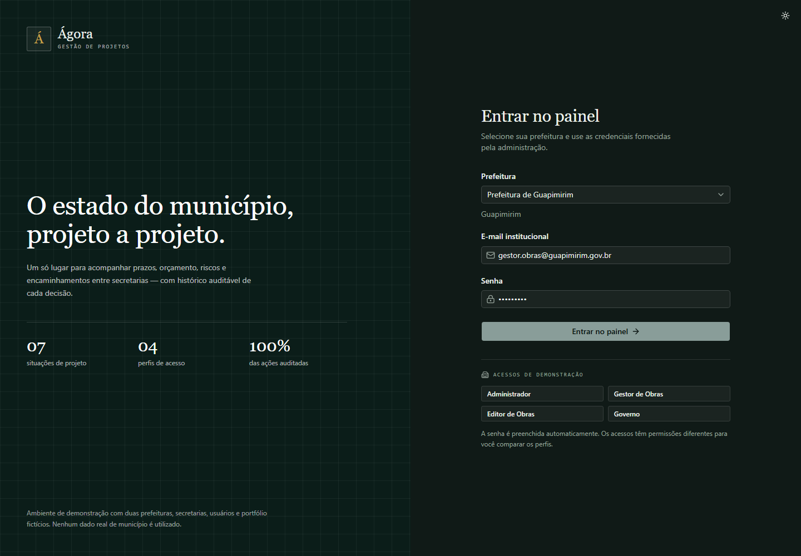
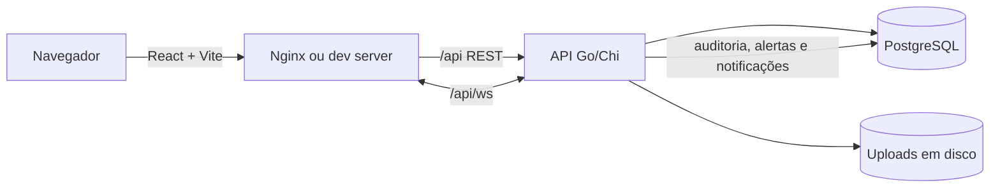

# Ágora

Painel de gestão de projetos municipais para acompanhar prazos, orçamento, riscos, atividades e encaminhamentos entre secretarias, com histórico auditável de cada decisão. Aplicação web em Go + PostgreSQL no backend e React + Vite no frontend, organizada como POC multi-prefeitura.



## O que você encontra

- Painel com indicadores do portfólio, projetos críticos, execução orçamentária e alertas.
- Cadastro de projetos com justificativa, objetivos, requisitos, riscos, 5W2H, SWOT, lições aprendidas e anexos.
- Planejamento avançado com PPA/LDO/LOA, linha de base, marcos, dependências, indicadores e modelos de projeto.
- Aprovações internas por etapa técnica, orçamentária e jurídica, com decisão e assinatura registrada.
- Financeiro por projeto com dotações, empenhos, pagamentos e contratos.
- Checklist documental com categoria, versão, validade e status.
- Partes interessadas com influência, interesse e estratégia de engajamento.
- Relatórios em XLSX e PDF, filtros salvos e agendamentos periódicos.
- Portal público de transparência por prefeitura, com detalhe de projetos, contratos e pagamentos.
- Notificações externas por e-mail SMTP e webhook de WhatsApp, com preferências por usuário.
- Permissões granulares por usuário, além do perfil de acesso.
- Atividades com responsável, prazo, prioridade e anexos próprios.
- Kanban por situação e cronograma (Gantt) com exportação em imagem.
- Encaminhamento de projetos entre secretarias com histórico.
- Controle de acesso por perfil (admin, gestor, editor e governo).
- Auditoria de ações com filtros e exportação CSV.
- Notificações em tempo real por WebSocket.
- Tema claro/escuro e identidade visual por prefeitura.
- Busca global com `Ctrl+K` em projetos, atividades, riscos, documentos, pessoas e fornecedores.

## Perfis de acesso

| Perfil | Escopo |
| --- | --- |
| `ADMIN` | Administra usuários, secretarias, cargos, identidade e auditoria; acesso total ao tenant. |
| `GESTOR` | Cria e gerencia projetos e atividades da própria secretaria; encaminha projetos. |
| `EDITOR` | Opera projetos e atividades da própria secretaria, sem exclusão de projeto. |
| `GOVERNO` | Leitura do portfólio, relatórios e cronograma. |

## Começando

Pré-requisitos: Go 1.25+, Node.js 22+ e Docker (ou um PostgreSQL 16 acessível).

```bash
# 1. Banco de dados
docker compose up -d postgres

# 2. API
cd backend
cp .env.example .env
go run .

# 3. Frontend, em outro terminal
cd frontend
npm install
npm run dev
```

Frontend em `http://localhost:5173`, API em `http://localhost:8090` e health check em `http://localhost:8090/api/health`.

### Acessos de demonstração

Com `SEED=true`, o banco é populado com duas prefeituras fictícias. Defina `SEED_PASSWORD` no ambiente para criar as contas demo; as senhas não ficam versionadas no repositório.

| Prefeitura | E-mail |
| --- | --- |
| Guapimirim | `admin@guapimirim.gov.br` |
| Guapimirim | `gestor.obras@guapimirim.gov.br` |
| Guapimirim | `editor.obras@guapimirim.gov.br` |
| Guapimirim | `prefeito@guapimirim.gov.br` |
| Magé | `admin@mage.gov.br` |

### Scripts

| Local | Comando | O que faz |
| --- | --- | --- |
| `frontend` | `npm run dev` | Servidor de desenvolvimento Vite. |
| `frontend` | `npm run build` | Typecheck (`tsc -b`) e build de produção. |
| `frontend` | `npm run lint` | Lint com Oxlint. |
| `frontend` | `npm run preview` | Pré-visualiza o build. |
| `backend` | `go run .` | Inicia a API e aplica migrações. |
| `backend` | `go test ./...` | Executa os testes. |
| raiz | `docker compose up --build` | Sobe PostgreSQL, API e frontend. |

## Rodando com Docker

```bash
cp .env.example .env
docker compose up --build
```

Acesse `http://localhost:8080`. O Nginx serve o frontend e encaminha `/api` para a API. Uploads e dados do PostgreSQL ficam nos volumes `agora-uploads` e `agora-pgdata`.

Se alterar a porta publicada do frontend, ajuste `ALLOWED_ORIGINS` para a URL pública correspondente (incluindo a porta). O WebSocket valida a origem e, sem esse ajuste, a interface fica "Offline".

## Configuração

| Variável | Padrão | Descrição |
| --- | --- | --- |
| `APP_ENV` | `development` | Use `production` para exigir configuração segura. |
| `PORT` | `8090` | Porta da API. |
| `DATABASE_URL` | PostgreSQL local na porta `5434` | Conexão do GORM. |
| `UPLOAD_DIR` | `data/uploads` | Diretório dos anexos. |
| `JWT_SECRET` | segredo de desenvolvimento | Em produção, exige 32+ caracteres. |
| `ALLOWED_ORIGINS` | `http://localhost:5173,http://127.0.0.1:5173` | Origens do CORS e do WebSocket. |
| `SEED` | `false` no binário; `true` no Compose | Popula dados de demonstração. |
| `PUBLIC_BASE_URL` | `http://localhost:5173` | Base usada nos links do portal e nas notificações. |
| `SMTP_HOST` / `SMTP_PORT` | vazio / `587` | Servidor SMTP para entrega por e-mail. |
| `SMTP_USER` / `SMTP_PASS` | vazio | Credenciais SMTP. |
| `SMTP_FROM` | vazio | Remetente das notificações. |
| `WHATSAPP_WEBHOOK_URL` | vazio | Webhook para entrega por WhatsApp. |
| `VITE_API_URL` | `http://localhost:8090/api` | URL da API usada no build do frontend. |

Em `APP_ENV=production`, a API recusa iniciar com segredo padrão, `SEED=true` ou origens `localhost`.

### Migrações

- Os arquivos SQL ficam em `backend/migrations` no padrão `000002_descricao.sql` e são aplicados em ordem no boot.
- Cada versão aplicada é registrada em `schema_migrations`; não há rollback automático.
- Bancos criados antes do runner são marcados com a migração inicial como baseline, sem recriar as tabelas existentes.

## Arquitetura



- **Backend** (`backend/`): Chi para rotas, GORM/PostgreSQL para persistência, JWT em cookie `HttpOnly`, bcrypt para senhas, WebSocket para tempo real, Excelize para XLSX e fpdf para PDF.
- **Frontend** (`frontend/`): React 19, React Router, TanStack Query, React Hook Form + Zod, Tailwind CSS v4 e componentes shadcn/ui.
- **Multi-tenant**: todas as consultas relevantes são filtradas por `tenant_id`; o tenant vem do usuário autenticado.
- **Status do projeto**: a situação operacional é derivada das atividades, dos prazos e das aprovações. Atividades canceladas saem do progresso; as suspensas bloqueiam a conclusão; o projeto só conclui com as três etapas de aprovação aprovadas. Alteração manual fica restrita a cancelar, suspender e retomar.

## Como funciona

1. O usuário entra com prefeitura, e-mail e senha; a API valida o tenant, bloqueia a conta após cinco tentativas inválidas por 15 minutos e grava um JWT de 16 horas em cookie `HttpOnly`. Requisições de escrita exigem o token CSRF da sessão.
2. O projeto nasce na secretaria do usuário (ou na escolhida por um admin), com prazo e justificativa. Mudanças de prazo exigem justificativa registrada.
3. Atividades alimentam o progresso do projeto e respeitam dependências: uma sucessora não inicia nem conclui antes da predecessora. Atividades podem ser suspensas, canceladas e retomadas; canceladas saem do progresso. Riscos, 5W2H, SWOT, lições e anexos ficam vinculados ao projeto; atividades também aceitam anexos.
4. Encaminhamentos transferem a responsabilidade entre secretarias e geram notificação em tempo real.
5. Toda ação relevante grava um registro de auditoria com usuário, entidade, detalhe, IP e data.
6. Relatórios e cronograma filtram por período e secretaria; o painel usa presets de período para concluídos e execução orçamentária.
7. Aprovações, financeiro, documentos, planejamento e partes interessadas ficam em abas do projeto e alimentam o portal público.
8. O scheduler da API envia resumos de relatórios agendados e registra cada tentativa de entrega interna, por e-mail ou WhatsApp.

## API

A API REST fica sob `/api`. Os grupos principais são:

| Grupo | Exemplos |
| --- | --- |
| Autenticação | `POST /auth/login`, `POST /auth/logout`, `GET /auth/me`, `GET /auth/csrf`, `PUT /auth/profile`, `POST /auth/change-password` |
| Portfólio | `GET/POST /projects`, `GET /projects/kanban`, `GET /projects/gantt`, `GET /projects/{id}` |
| Projeto | atividades, riscos, ações 5W2H, SWOT, lições, anexos e histórico |
| Governança | `GET/PUT /projects/{id}/approvals`, `GET/POST /projects/{id}/documents`, `GET/POST /projects/{id}/stakeholders` |
| Planejamento | `GET/POST /projects/{id}/milestones`, dependências, indicadores e `/templates` |
| Financeiro | dotações, empenhos, pagamentos, contratos e `/suppliers` |
| Relatórios | `GET /reports/summary`, `GET /reports/projects.xlsx`, `GET /reports/projects.pdf`, filtros salvos e agendamentos |
| Portal público | `GET /public/{slug}/transparency`, `GET /public/{slug}/projects/{id}` |
| Operação | `GET /dashboard`, `GET /search`, notificações, preferências de entrega e WebSocket |
| Administração | usuários, permissões, secretarias, cargos, branding, `GET /logs` e `GET /logs/export` |

O detalhamento de rotas, campos e regras está em [`ESPECIFICACAO.md`](ESPECIFICACAO.md); a referência de telas está em [`TELAS.md`](TELAS.md).

## Estrutura do projeto

```text
.
├── backend/
│   ├── main.go
│   ├── migrations/        # migrações SQL versionadas
│   └── internal/
│       ├── auth/          # JWT, CSRF e senhas
│       ├── config/        # variáveis de ambiente
│       ├── database/      # conexão, runner de migrações e seed
│       ├── handlers/      # regras HTTP
│       ├── middleware/    # autenticação, CSRF e autorização
│       ├── models/        # entidades GORM
│       ├── realtime/      # hub WebSocket
│       └── server/        # rotas e middlewares
├── frontend/
│   └── src/
│       ├── components/    # UI, projeto e administração
│       ├── lib/           # API, autenticação, formatos e tempo real
│       └── pages/         # dashboard, projetos, relatórios, admin
├── docs/screenshots/
├── docker-compose.yml
├── ESPECIFICACAO.md
└── TELAS.md
```

## Testes e CI

```bash
cd backend && go test ./...
cd frontend && npm run build && npm run lint
```

O workflow em [`.github/workflows/ci.yml`](.github/workflows/ci.yml) roda `gofmt`, `go vet`, testes do backend, build/lint do frontend e build das duas imagens Docker.

## Limitações conhecidas

- É uma POC: não há recuperação de senha por e-mail, MFA, gestão de sessões ou exclusão de conta.
- Anexos ficam em disco local; em produção, use volume persistente ou armazenamento de objetos.
- As migrações SQL em `backend/migrations` são aplicadas em ordem e registradas em `schema_migrations`; não há rollback automatizado.
- A sessão usa cookie `HttpOnly` e CSRF para escrita; em produção, TLS é obrigatório para o cookie `Secure`.
- A assinatura de aprovações é um registro interno e não substitui certificação digital ICP-Brasil.
- E-mail e WhatsApp dependem de SMTP/webhook configurados; sem credenciais, as entregas ficam registradas como `SEM_CONFIGURACAO`.
- O portal público expõe apenas dados marcados para transparência e não possui autenticação de cidadão.
- Não há testes E2E nem testes de carga; a cobertura atual é unitária no backend.
- O frontend usa code splitting por rota; o chunk inicial foi reduzido, mas ainda não há orçamento de performance no CI.
- Não há licença definida no repositório.

## Antes de publicar

Defina `APP_ENV=production`, um `JWT_SECRET` aleatório com 32+ caracteres, `SEED=false`, `ALLOWED_ORIGINS` com o domínio real e TLS no proxy. O cookie de sessão só usa `Secure` quando `APP_ENV=production`, então publique sempre atrás de HTTPS. Faça backup do PostgreSQL e do diretório de uploads, e monitore os logs da API.
